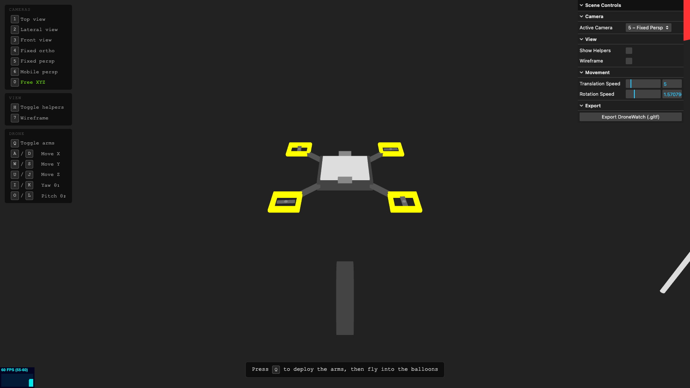
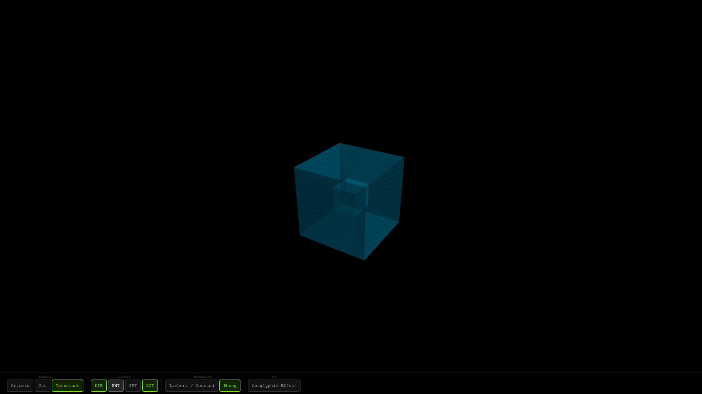

# Three.js Demos

Two interactive Three.js scenes built for the Computer Graphics course at Instituto Superior Técnico (2025/2026).

Check them out at **[threejs.inesiscosta.com](https://threejs.inesiscosta.com)**.

## Drone Watch

A smartwatch that unfolds four rotor arms, lifts off the wrist and flies around popping balloons. Needs a keyboard.



### Controls

Press **Q** first. The drone can't move until its arms are fully deployed.

| Key | Action |
|---|---|
| `Q` | Deploy / retract the arms (the strap stays behind on the first deploy) |
| `A` `D` · `W` `S` · `U` `J` | Move along X · Y · Z |
| `I` `K` | Yaw |
| `O` `L` | Pitch, limited to ±60° |
| `1` – `6` | Top, side and front orthographic cameras; fixed orthographic and perspective cameras; onboard camera |
| `0` | Free orbit camera |
| `7` | Wireframe |
| `H` | Axes and camera helpers |

### How it Works

- **Built from primitives.** Every part is a box, cylinder, cone, sphere or torus, arranged in a scene graph: the watch body, a strap bent along a cosine curve, and four arms rotated 45° apart. Each arm slides along its own axis to extend and carries a rotor with a guard ring, hub and spinning blade.
- **Manual transforms.** The drone's matrix isn't updated automatically. Each frame, yaw and pitch are composed as `R = Ry · Rx`, a translation `T` is built from the accumulated position, and the matrix is set directly to `T · R`.
- **Staying in bounds.** The position is clamped so every rotor, wherever it points after rotation, stays inside a 100-unit box around the origin.
- **Collisions.** Rotors and balloons are treated as spheres. When a deployed rotor touches a balloon, the balloon shrinks away and input pauses until it's gone.

## Pepper's Ghost

A hologram display. The screen shows a single model on pure black. Lay a phone or tablet flat under a sheet of glass or acrylic at 45°, and the reflection looks like it's floating in mid-air. Everything is controlled by tapping, so it works on phones.



### How it Works

- **Three models.** A tesseract built vertex by vertex, a cat, and the Artemis rocket, the last two loaded from glTF.
- **The tesseract.** An outer and an inner cube joined by connecting faces, all semi-transparent. A normal map of concentric rings, drawn on a canvas at runtime, makes each face ripple under the light. The tesseract spins and pulses in size.
- **Lighting and shading.** A directional light and a dim ambient light, plus two point lights and two spotlights attached to each model. Each light type can be toggled, and every model can switch between Lambert (Gouraud) and Phong shading or turn lighting off.
- **Anaglyph mode.** Renders the scene for red/cyan 3D glasses.

## Running Locally

The pages use ES modules and load three.js from a CDN, so they need to be served over HTTP rather than opened as files:

```bash
python3 -m http.server
```

Then open <http://localhost:8000> and pick a demo.
